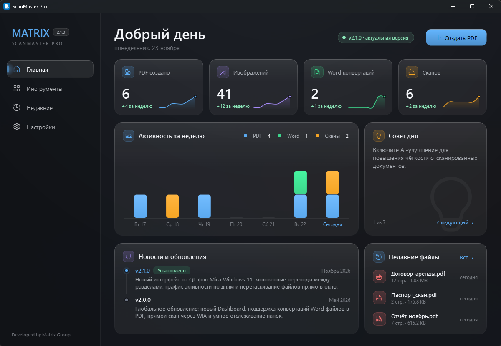

# ScanMaster Pro

  
   
  <b>Инженерия Эффективности: Профессиональный комбайн для работы с PDF.</b>

  
  
  
  

---

## О проекте

**ScanMaster Pro** — это мощное настольное приложение на базе Python, созданное для автоматизации ежедневных задач с документами. Объединяйте, улучшайте и защищайте ваши сканы в один клик, не покидая пределов своего ПК.

Мы верим, что работа с документами должна быть быстрой, а данные — оставаться в безопасности.

### Ключевые возможности:

- Изображения → PDF: Склеивайте сканы JPG, PNG, BMP и TIFF в один документ, меняйте порядок перетаскиванием, поворачивайте страницы, настраивайте сжатие.
- Word → PDF: Пакетная конвертация .docx через Microsoft Word или LibreOffice.
- Сканер: Прямое сканирование через WIA и автодобавление файлов из папки, куда сохраняет принтер.
- AI-улучшение: Коррекция контраста и резкости отсканированных страниц.
- Пароль на PDF: Шифрование итогового документа прямо при сохранении.
- Локальная обработка: Файлы не покидают ваш компьютер.
- Темы оформления: готовые темы и конструктор своей — акцент, фон Mica/Acrylic, прозрачность, скругление; любой цвет можно задать кодом.
- Шрифты и значок: 18 встроенных шрифтов и системные, 10 значков приложения или свой файл.
- Редактор PDF: откройте готовый PDF — переставьте, поверните, удалите или добавьте страницы, разделите файл или сожмите его до нужного размера.
- Правки поверх страниц: впишите текст, замажьте и исправьте, выделите маркером и фигурами, поставьте подпись и печать из своей библиотеки; «Скрыть» удаляет данные из файла насовсем.
- Распознавание текста: сканы в PDF становятся «живыми» — работают поиск, выделение и копирование текста; распознаёт встроенный OCR Windows, без интернета.

### Что нового

**2.6.0** — распознавание текста: галочка «Распознать текст» в конвертере и кнопка в редакторе PDF, «Скопировать текст страницы» (Ctrl+Shift+C), вписанный текст тоже находится поиском. В настройках — «Сохранить журнал». Усилена безопасность: обновления только с точного адреса релиза, «Скрыть» убирает данные и из форм, закладок и вложений, документы Word конвертируются без обращений к внешним ссылкам.

**2.5.0** — правки поверх страниц PDF: текст, замазка, маркер, фигуры, подписи и печати (нарисовать или загрузить фото — фон уберётся сам), «Скрыть» с настоящим удалением данных. ScanMaster помнит свои правки и даёт поправить их при следующем открытии.

**2.4.0** — редактор PDF: работа со страницами готового файла (перестановка перетаскиванием, поворот, удаление, добавление PDF и фото), разделение на файлы и сжатие, в том числе «не больше N МБ». Пароль и ограничения файла сохраняются.

**2.3.0** — персонализация: выбор значка приложения (10 готовых или свой файл), 18 встроенных шрифтов и системные, темы кодом — вкладка «Код» в редакторе темы с проверкой на лету.

**2.2.0** — темы оформления: шесть готовых тем, конструктор своей темы с живым предпросмотром, импорт и экспорт файлов `.smtheme`.

**2.1.1** — обновление безопасности: макросы в документах Word не выполняются при конвертации, обновления проверяются строже, изображения читаются только безопасными декодерами.

**2.1.0:**

- Новый интерфейс на Qt в стиле Windows 11: фон Mica, стеклянные карточки, плавные анимации.
- Мгновенные переходы между разделами и быстрая очередь даже на сотни страниц.
- Главная с графиком активности по дням, трендами и недавними файлами.
- Перетаскивание файлов прямо в окно — они сами попадают в нужную очередь.

---

## Интерфейс

  
   
  <i>Главная: статистика, активность за неделю и недавние файлы</i>

---

## Технологический стек

Проект построен на современных библиотеках Python:
- **PySide6 (Qt 6)** — интерфейс с фоном Mica Windows 11.
- **Pillow, img2pdf, pikepdf** — обработка изображений, сборка и шифрование PDF.
- **pywin32 (COM)** — Microsoft Word, WIA-сканер, ярлык и автозапуск.

---

## ⚠️ Отказ от ответственности

Проект разработан исключительно в рамках **учебной деятельности**. Все совпадения с существующими коммерческими программными продуктами являются случайными.
